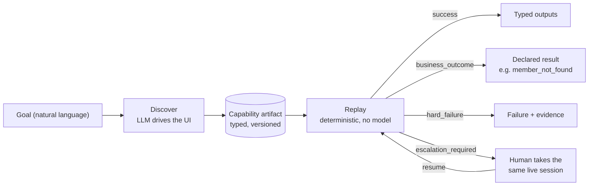

# ROTE

> **Your agent discovers a UI task once. Then it runs forever, deterministically, with no model in the loop.**

[](https://github.com/Kolerr-Lab/rote-agent/actions/workflows/ci.yml)
[](./LICENSE)
[](https://nodejs.org)
[](https://www.typescriptlang.org)

## The problem

Many core back-office applications, especially in banking and other regulated industries, have no API.
The only way in is to drive the UI like a human operator. LLM computer-use agents can do that, but they
are slow, expensive, and non-deterministic on every single run: the same task can take a different path
each time, and every run pays for model calls. That is hard to trust with production workflows.

ROTE splits the problem in two. A model is used **once**, to figure out how a task is done. After that,
the task is a typed, versioned artifact that is replayed deterministically, with no model involved.

## How it works

1. **Discover.** An LLM drives a real UI to complete a natural-language goal (observe, decide, act).
2. **Record.** The successful run is saved as a typed *capability artifact*, decoupled from the model transcript.
3. **Replay.** Production agents invoke the artifact. Replay resolves targets by ranked locators and
   checkpoints, and never calls a model.
4. **Escalate.** When replay is stuck or reaches a risky step, a human takes over the *same live session*
   and then hands control back.



## Features

- **Discovery agent** (`src/agent`, `src/llm`): observe, decide, act, driven by OpenAI, with an offline
  `MockLlmProvider` for deterministic development and tests.
- **Typed artifacts**: a Zod schema is the source of truth, with an exported JSON Schema.
- **Ranked locator resolution**: role/name, then label and row anchoring, then attributes, then a
  last-resort structural selector, each checked against invariants. Fallback use is logged as a drift signal.
- **Error taxonomy**: every replay returns one of `success | business_outcome | hard_failure | escalation_required`.
- **Bounded recovery**: declared rules (`dismiss`, `retry`, `reauth`) with attempt limits, never open-ended.
- **Human control lease and handoff**: a control-transfer state machine lets a human operate the same live
  browser session, then returns control to automation.
- **Safety**: route and action allowlist, risk policy (`auto | confirm | block`), and redaction before anything is persisted.
- **Multi-tenant replay**: one artifact replays across rebranded UIs through tenant profiles (base URL and label overrides).
- **Agent-callable capability catalog**: artifacts are exposed as typed capabilities that an agent can list and invoke.

## Quickstart

Requires **Node 20+**.

```bash
npm install
npx playwright install chromium   # first time only
npm test                          # offline: schema, surface, discovery, replay taxonomy, escalation, catalog
```

Start the bundled mock legacy bank (tenants at `/t/acme` and `/t/globus`):

```bash
npm run mock-bank
```

In a second terminal, discover a capability, replay it, and call it through the catalog:

```bash
# Discover (offline, deterministic mock provider). Writes an artifact under evidence/ and catalog/
npm run discover -- --spec specs/read-savings.json --tenant acme --provider mock

# Replay deterministically (no model)
npm run replay -- --artifact catalog/member.read-savings-balance.json --tenant acme \
  --input userId=teller01 --input password=demo-pass --input memberId=12345

# Invoke the same artifact on the rebranded tenant via the catalog
npm run catalog -- invoke member.read-savings-balance --tenant globus \
  --input userId=teller01 --input password=demo-pass --input memberId=12345
```

> **Replay needs no API key.** Only a real discovery run (`--provider openai`) needs one: export
> `OPENAI_API_KEY` in your shell (see [`.env.example`](./.env.example) for all variables). Keys are read
> from the environment only and are never written to artifacts or traces. Add `--headed` to any
> `discover` or `replay` command to watch the browser.

If Chromium is already installed, point to it with `CUA_CHROMIUM_PATH=/path/to/chrome` to skip the download.

### Commands

| Command | What it does |
|---|---|
| `npm test` | Full deterministic test suite (offline). |
| `npm run typecheck` | `tsc --noEmit`. |
| `npm run evidence` | Regenerate `/evidence` end to end (offline). |
| `npm run schema:export` | Write `schema/capability.schema.json` from the Zod schema. |
| `npm run mock-bank -- [--port 4010]` | Serve the mock legacy bank. |
| `npm run discover -- --spec <f> --tenant <id> --provider <mock\|openai> [--headed]` | Discovery run, emits an artifact. |
| `npm run replay -- --artifact <f> --tenant <id> --input k=v ... [--headed]` | Deterministic replay. |
| `npm run catalog -- list` / `catalog -- invoke <id> --tenant <id> --input k=v` | Agent-facing catalog. |
| `npm run operator -- [--port 4020]` | Minimal operator panel (renders pending interventions). |

## Example

A capability artifact (abridged from [`catalog/member.read-savings-balance.json`](./catalog/member.read-savings-balance.json)):

```json
{
  "schemaVersion": "1.0.0",
  "capabilityId": "member.read-savings-balance",
  "target": { "appFamily": "acme-corebanking", "surfaceKind": "web", "entryPoint": "/" },
  "inputs": [
    { "name": "userId", "type": "string", "required": true, "sensitive": false },
    { "name": "password", "type": "string", "required": true, "sensitive": true },
    { "name": "memberId", "type": "string", "required": true, "sensitive": false }
  ],
  "steps": [
    {
      "id": "s1",
      "intent": "type into \"User ID\"",
      "action": { "type": "type" },
      "target": {
        "strategies": [
          { "by": "label", "label": "User ID" },
          { "by": "attr", "name": "name", "value": "userId" }
        ],
        "invariants": { "visible": true, "editable": true }
      },
      "inputBinding": { "param": "userId" }
    }
  ]
}
```

Replay results (from the committed runs in [`evidence/`](./evidence)):

```jsonc
// evidence/02-replay-success/result.json
{ "status": "success", "outputs": { "savingsBalance": "$4,210.55" }, "recovery": [] }

// evidence/03-replay-business-not-found/result.json
{ "status": "business_outcome", "code": "member_not_found", "recovery": [] }
```

See [`docs/artifact-spec.md`](./docs/artifact-spec.md) for the full schema.

## Quick tour

- **Read first:** [`docs/architecture.md`](./docs/architecture.md), then [`docs/design-notes.md`](./docs/design-notes.md) for trade-offs.
- **Run the demo:** follow the [Quickstart](#quickstart). Everything targets a local mock bank and needs no keys.
- **See the evidence:** [`evidence/`](./evidence) holds a discovery run plus replay runs covering success,
  a business outcome, a recovered interstitial, a hard failure, and cross-tenant reuse.

## Project layout

| Path | Purpose |
|---|---|
| `src/agent` | Discovery loop (observe, decide, act) and artifact recording. |
| `src/llm` | `LlmProvider` interface, OpenAI provider, offline mock provider, prompts. |
| `src/artifact` | Zod capability schema, JSON Schema export, artifact store. |
| `src/replay` | Deterministic replay engine, result contract, error taxonomy, recovery. |
| `src/escalation` | Control lease, handoff orchestration, minimal operator panel. |
| `src/safety` | Allowlist enforcement, risk policy, redaction. |
| `src/surface` | `Surface` interface and the Playwright `WebSurface`, locator resolution. |
| `src/tenant` | Tenant profiles (base URL and label overrides). |
| `src/catalog` | Agent-callable capability catalog. |
| `mock-bank/` | Standalone hostile legacy bank: frameset, nested tables, no test IDs, injectable failures, two tenants. |
| `docs/` | Architecture, artifact spec, safety, design notes, governance protocols. |
| `tests/` | Deterministic offline tests. |
| `evidence/` | Committed discovery and replay runs. |
| `schema/` | Exported JSON Schema for the capability artifact. |

## Roadmap

- MCP server exposing the capability catalog
- More LLM providers
- Artifact drift detection and self-repair
- Hosted runner
- Dashboard

## Status

Early. APIs and the artifact schema may change before 1.0. Contributions are welcome; see
[CONTRIBUTING.md](./CONTRIBUTING.md).

Licensed under [Apache-2.0](./LICENSE). Maintained by Kolerr Lab, Inc.
Contact: [ricky@kolerr.com](mailto:ricky@kolerr.com). Security issues: see [SECURITY.md](./SECURITY.md).
