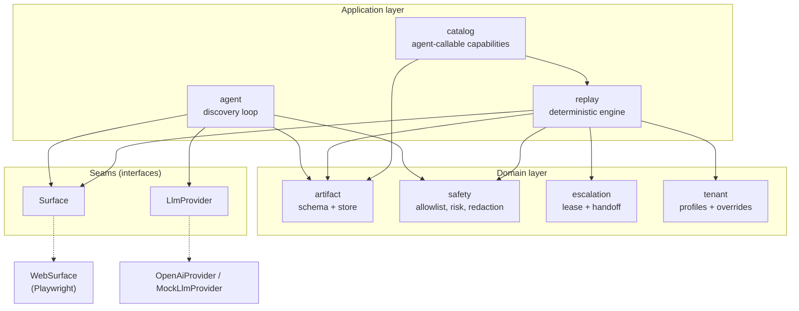

# Architecture

ROTE turns a one-time, model-driven exploration of a UI into a typed capability that is replayed
deterministically. This page describes the components, how data flows between them, and the trade-offs
behind the design. For the full rationale see [design-notes.md](./design-notes.md).

## Components

| Module | Responsibility |
|---|---|
| `src/agent` | Observe, decide, act loop against a live surface; turns a successful run into a parameterized artifact. |
| `src/llm` | `LlmProvider` interface, OpenAI provider, offline `MockLlmProvider`, prompts. |
| `src/artifact` | Zod schema (source of truth), JSON Schema export, artifact store with checksum validation. |
| `src/replay` | Deterministic replay engine, result contract, error taxonomy, bounded recovery. |
| `src/escalation` | Control lease state machine, handoff orchestration, minimal operator panel. |
| `src/safety` | Allowlist enforcement, risk classification and policy, redaction. |
| `src/surface` | `Surface` interface, Playwright `WebSurface`, locator resolution and checkpoints. |
| `src/tenant` | Tenant profiles: base URL and label overrides applied at replay. |
| `src/catalog` | Typed, agent-callable listing and invocation of stored capabilities. |
| `mock-bank/` | A hostile legacy bank (framesets, no test IDs, injectable failures, two tenants) used for development and tests. |

**Key boundary: `replay` never imports `llm`.** Discovery and production execution are different
programs that share the artifact and the surface. The model's job ends when the artifact is written.

## Data flow

1. **Discovery.** `agent` observes the surface, asks the `LlmProvider` for the next action, checks it
   against the allowlist, and acts. Each step is recorded with ranked locators and checkpoints. The model's
   reasoning is written to the trace for debugging but is never copied into the artifact.
2. **Recording.** The run is emitted as a `Capability`: typed inputs and outputs, ordered steps, a success
   condition, declared business outcomes, recovery rules, guardrails, and provenance that points at the
   evidence. Sensitive values are redacted before anything is persisted.
3. **Replay.** The caller (an agent, the CLI, or the catalog) supplies typed inputs. The replay engine
   resolves each target, acts, and verifies checkpoints, with no model in the loop.
4. **Result.** Replay returns one of four results (see below), plus a trace and failure screenshots under `evidence/`.

## Determinism

Replay is deterministic because:

- Targets resolve by a **ranked strategy list with invariant checks**, not one brittle selector.
- All waiting is on **state and checkpoints**, never wall-clock time.
- **No model participates.**
- When a fallback strategy wins, replay logs `locator.fallback_used`, a per-run drift signal.

## Error handling

Every replay is classified by a four-way result contract:

| Status | Meaning |
|---|---|
| `success` | Typed outputs, plus a list of any recoveries applied. |
| `business_outcome` | A declared, expected non-success (for example `member_not_found`). Returned to the caller, not an error. |
| `hard_failure` | A `FailureCategory` (`LOCATOR_UNRESOLVED`, `CHECKPOINT_FAILED`, `UNEXPECTED_STATE`, `TIMEOUT`, `GUARDRAIL_BLOCKED`, `INVALID_INPUT`, `PROVIDER_ERROR`) with `{stepId, expected, observed, evidenceRef}` and a screenshot. |
| `escalation_required` | A human is needed; a request describes the goal, the stopped step and a screenshot. |

At every step boundary replay checks declared **business outcomes** first, then bounded **recovery rules**
(`dismiss` a known interstitial, `retry` a transient failure by reloading a frame, `reauth` which escalates),
and only then acts. Anything unresolved after fallbacks and recovery is a hard failure with debuggable evidence.

## Escalation

A `SessionController` is the single writer of a control lease (`AGENT` or `HUMAN`) over the one live
session, with the state machine `RUNNING -> PAUSED -> HUMAN_CONTROL -> RESUMING -> RUNNING`. A human operates
the same browser session the automation was driving, human actions are recorded to the trace, and replay
resumes from the correct step. See [safety.md](./safety.md#escalation).

## Multi-tenant replay

Artifacts key on `appFamily`, not a tenant URL. A `TenantProfile` supplies the base URL and label overrides,
applied to both locators and checkpoints, so a capability recorded on tenant `acme` replays on rebranded
`globus` where "Savings Balance" reads "Savings Bal.".

## Trade-offs

- **Single process, clean seams.** No queues or workers yet. `Surface` and `LlmProvider` are the seams that let this scale later.
- **Local mock target.** A hostile mock bank lets failure states be injected on demand and keeps runs
  reproducible offline. The trade-off is less proof against an uncontrolled third-party site.
- **Web only today.** Locators are defined against the accessibility tree so a desktop `Surface` could reuse the
  same artifact schema, but only `WebSurface` is implemented.
- **Minimal operator UI.** The control-transfer mechanism is real; the operator panel is intentionally small.
